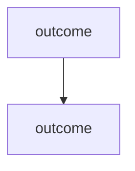

<!-- An epic: the parent issue of 2 or more outcomes. Each child uses issue.md. -->

## Goal

<who> can now <do X>.

Success signal: <one measurable sign the whole epic worked, and where it is measured>.

## Why

<The problem, then its evidence.>

## Impact

<Audience predicate> → <count> (<query or source>)

## Approach

1. <3–6 numbered decisions: contracts, data, flag. No code.>

## Children

| # | Issue | Outcome | Blocked by | Verify |
| --- | --- | --- | --- | --- |
| 1 | <id> | <who> can now <do X> | none | <the child's end-to-end check> |



<!-- Generated from the children's native blocked-by relations. Never edit by hand. The edge A --> B means A blocks B. Drop the graph when the profile or a test showed Linear does not render it. -->

## Epic done when

<One end-to-end check across all children.>

## Fact delta

```delta
<the union of the children's rows>
```

## Out of scope

- <What this won't touch.>
- Later: <an outcome nobody commits to now>

## Risks

- <A risk and what limits it.>

## Open

- <An unverified premise or question> · <owner>
